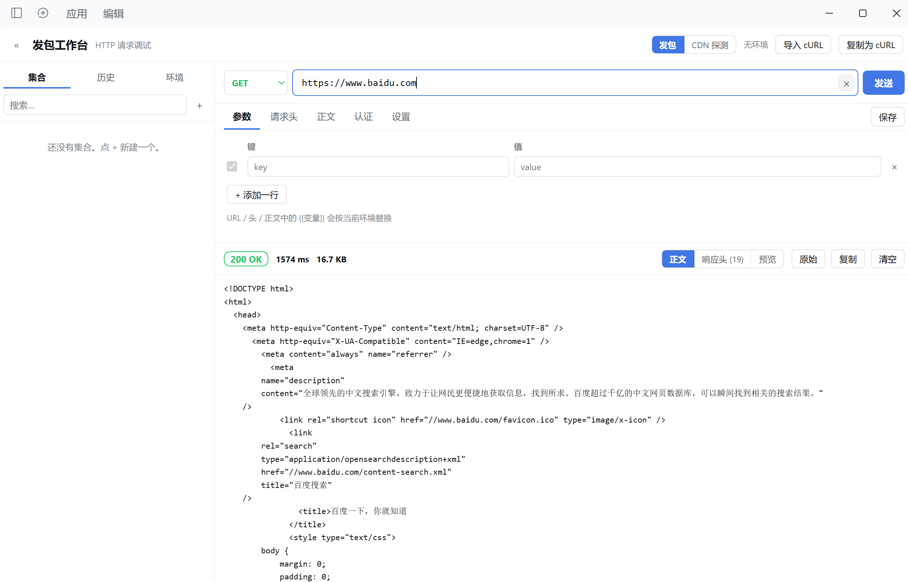
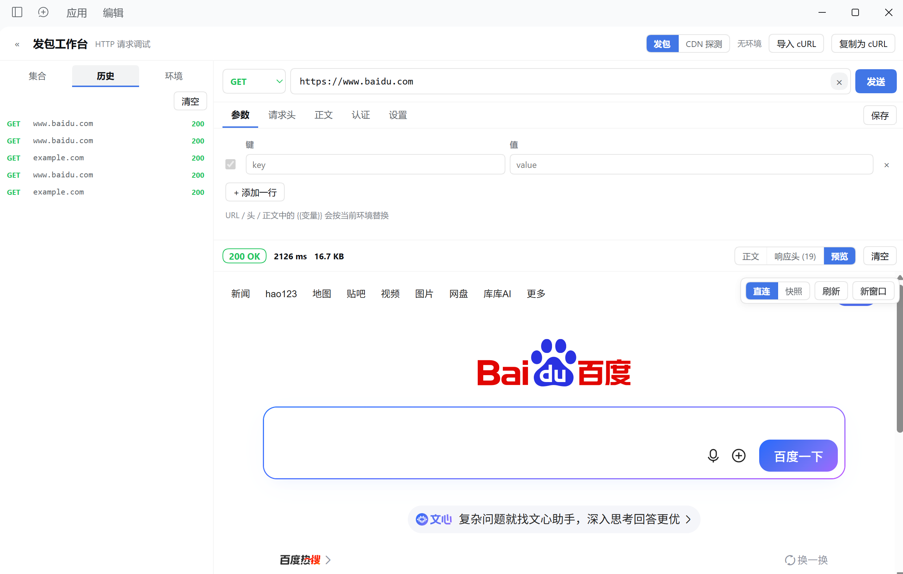
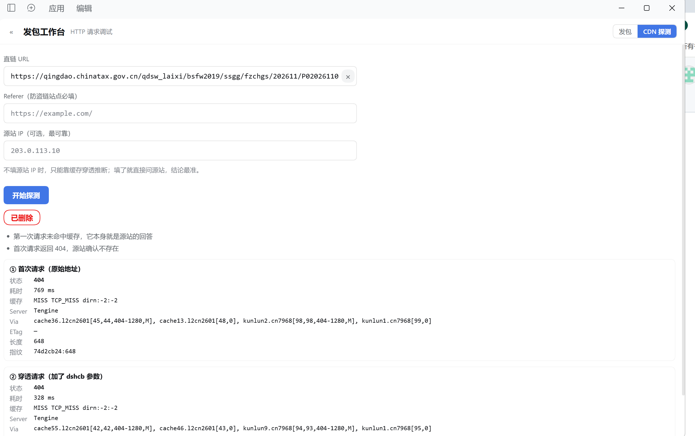

# dsh-postman-desktop · 发包工作台

Postman 式的 HTTP 调试面板，直接长在 DeepSeek Harness 的 Web GUI 里。侧边栏「发包台」进入，并且给 agent 一个共用同一条发送链路的 `http_request_desktop` 工具。

[](https://www.npmjs.com/package/dsh-postman-desktop)
[](https://github.com/zhounian6688-like/dsh-postman-desktop/releases)

- 宿主：DeepSeek Harness（`dsh`）Web profile，`engines.dsh >= 0.2.1-rc.1`
- 依赖：零运行时依赖，只用 `node:` 内置模块；前端是纯 `React.createElement`，无构建步骤
- 数据：全部落在 `$DSH_HOME/postman-desktop/store.json`（`0600`），一个文件即可备份或手改

## 界面



| 历史：每条带状态码，点一下还原整个请求 | CDN 源站探测：判定「已删除」还是「只是边缘缓存」 |
|---|---|
|  |  |

真实截图，不是效果图：第一张是发一个 GET 拿到 `200 OK` 与 HTML 正文，第二张是历史列表加预览页签，第三张对同一个站点连读两次并给出「已删除」的结论。

## 安装

```sh
# 已发 npm 时
dsh plugin --profile web add dsh-postman-desktop

# 或直接用 GitHub Release 的打包文件
dsh plugin --profile web add https://github.com/zhounian6688-like/dsh-postman-desktop/releases/latest/download/dsh-postman-desktop-1.0.1.tgz
```

装完刷新页面（或重启桌面版）即可看到侧边栏图标。本包同时提供 host 半与 client 半，`dsh.bundle` 与 `dsh.client` 都由 `cordis.patch.yml` 自动挂载，不需要额外的 profile 配置。

## 面板能力

- **请求构建**：方法（GET/POST/PUT/PATCH/DELETE/HEAD/OPTIONS）、URL、Query 参数、请求头（常用头一键补全）、正文（none / raw JSON·Text·XML·HTML·JS / form-urlencoded / form-data / binary）、认证（Bearer / Basic / API Key（header 或 query）/ 自定义 Header）。
- **环境变量**：多环境管理，`{{变量}}` 在 URL、参数、请求头、正文、认证字段里都会被替换，支持嵌套（最多 5 层）。
- **集合**：集合 → 文件夹 → 请求三层树，支持新建、重命名、复制、删除、搜索。打开集合里的请求后编辑会自动写回集合。
- **历史**：每次发送自动记录方法 / URL / 状态码 / 耗时，点一下把完整请求还原进构建器。最多保留 120 条。
- **响应查看**：状态码、耗时、大小、重定向次数；响应头表格；正文支持 JSON/XML 美化、原始视图、图片预览、二进制提示；超过 4MB 截断并提示。
- **cURL 互转**：粘贴 curl 命令解析成请求（支持 `-X -H -d --data-raw --data-urlencode -F -u -b -A -e -I -k -L --url`），也能把当前请求复制成 curl。
- **CDN 源站探测**：同一个 URL 读两次（原样 + 加时间戳破缓存），可选再指定源站 IP 直连并保留原 Host/SNI。用来区分「文件真没了」和「CDN 边缘在骗你」。带签名/过期参数的 URL 会被单独标注。
- **快捷键**：URL 框回车直接发送；`Ctrl/Cmd + Enter` 全局发送。

## 给 agent 的工具

`http_request_desktop` —— 与面板共用同一条发送链路（同一套变量解析、认证、正文编码、重定向处理），所以面板里调通的请求，agent 可以直接复现。

```
http_request_desktop(method="POST", url="https://api.example.com/v1/users",
                     headers={"Content-Type":"application/json"},
                     body='{"name":"a"}', bodyType="json")
```

| 参数 | 类型 | 说明 |
|---|---|---|
| `url` | string | **必填**。完整 URL，可含 `{{变量}}` |
| `method` | string | HTTP 方法；省略时，有正文用 POST，没有用 GET |
| `headers` | object | 请求头键值对 |
| `body` | string | 原始正文 |
| `bodyType` | string | `json` / `text` / `xml` / `html` / `urlencoded`，决定默认 `Content-Type`（默认 `json`） |
| `form` | array | 表单字段；给了 `form` 就按 `x-www-form-urlencoded` 发送 |
| `environment` | string | 环境名或 id，用于解析 `{{变量}}`；省略则用当前激活环境 |
| `timeoutMs` | integer | 超时毫秒，默认 30000，上限 300000 |
| `followRedirects` | boolean | 是否跟随重定向，默认 `true` |
| `verifyTls` | boolean | 是否校验 TLS 证书，默认 `true` |

返回的是纯文本摘要：状态行（如 `GET https://… → 200 OK 809ms 577B`）、响应头、正文。正文超过 20000 字符会被截断。

## 数据存放

`$DSH_HOME/postman-desktop/store.json`（`DSH_HOME` 未设置时是 `~/.dsh`，即 `~/.dsh/postman-desktop/store.json`），写入权限 `0600`。

集合、环境、历史全在这一个文件里。它就是一个普通 JSON，可以直接备份、版本管理或手改。

## HTTP 接口

同源、仅供本页面调用：`Origin` 与 `Host` 不一致时返回 `403`。

| 方法 | 路径 | 用途 |
|---|---|---|
| GET | `/api/dsh-postman-desktop/store` | 读全部数据 |
| PUT / POST | `/api/dsh-postman-desktop/store` | 整体覆盖写入 |
| POST | `/api/dsh-postman-desktop/send` | 发送一次请求 |
| POST | `/api/dsh-postman-desktop/curl` | 解析 curl 命令 |
| GET | `/api/dsh-postman-desktop/history` | 读历史 |
| DELETE | `/api/dsh-postman-desktop/history` | 清空历史 |
| POST | `/api/dsh-postman-desktop/probe` | CDN 源站探测 |
| GET | `/api/dsh-postman-desktop/health` | 存活与存储路径 |

## 边界

- 只支持 `http:` / `https:`。
- 请求正文上限 16MB，响应读取上限 4MB（超出部分丢弃并标记截断）。
- 默认超时 30s，可调范围 1ms–300000ms；重定向默认最多 10 跳，可调到 20 跳。
- `binary` 与 `form-data` 里的 `@路径` 由 **host 侧**读取，路径必须是 host 进程可访问的位置（不是浏览器所在设备的任意路径）。
- 关闭 TLS 校验（`verifyTls: false`）只影响本次请求的 `rejectUnauthorized`。
- 面板和 agent 工具用的是同一套发送引擎，所以两者的边界完全一致。

## 与 dsh-postman 的关系

本包是桌面 / Web 版（`webServer` 路由 + `dsh.client` 面板）。路由前缀是 `/api/dsh-postman-desktop`，与手机版 `dsh-postman` 的 `/api/dsh-postman` **不冲突**，两者可以并存，但侧边栏会出现两个入口。

## 发布前要做的一件事

`package.json` 里的 `author` 与 `repository` / `homepage` / `bugs` 还带着占位符。填一次即可：

```sh
node scripts/set-owner.mjs <github-owner> "Your Name" you@example.com
```

## 开发

```sh
npm test        # 无需 dsh 运行时：假 ctx 注册工具与路由，断言同源校验拒绝跨站请求
```

`test/smoke.mjs` 用 `DSH_HOME` 指向临时目录，不会碰真实数据。

## License

MIT

---

## English

A Postman-style HTTP workbench that lives inside the DeepSeek Harness Web GUI. One sidebar entry, one agent tool, one send path.

## Screenshots


| History — every send with its status code, one click to restore | CDN origin probe — "gone" vs "the edge is lying" |
|---|---|
|  |  |

Real screenshots, not mockups: the first sends a GET and shows `200 OK` with the HTML body, the second is the history list with the preview tab, the third reads one site twice and concludes the object is gone.

```sh
dsh plugin --profile web add dsh-postman-desktop
```

- **Request builder** — method, URL, query params, headers, body (none / raw JSON·Text·XML·HTML·JS / form-urlencoded / form-data / binary), auth (Bearer / Basic / API Key / custom header).
- **Environments** — `{{var}}` substitution across URL, params, headers, body and auth, nested up to 5 levels.
- **Collections** — collection → folder → request tree with rename, duplicate, delete and search.
- **History** — the last 120 sends, one click to restore a full request.
- **Response inspector** — status, time, size, redirect count, headers table; JSON/XML pretty-print, raw view, image preview, binary notice; truncated past 4MB.
- **cURL** — parse an arbitrary curl command into a request, or copy the current request as curl.
- **CDN origin probe** — two reads (plain + cache-busted) plus an optional pinned-origin read that keeps the CDN Host/SNI, so "the file is gone" can be told apart from "the edge is lying".
- **Agent tool** — `http_request_desktop` drives the same engine; `environment` selects an environment, output is truncated at 20000 characters.
- **Store** — `$DSH_HOME/postman-desktop/store.json`, mode `0600`.
- **Limits** — 16MB request body, 4MB response read, 30s default timeout (max 300s), 10 redirects by default (max 20).